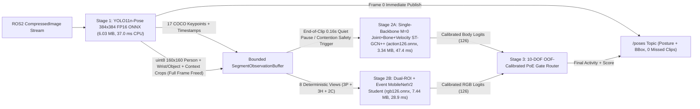

# Weekly Engineering Report — Darvin Subnet 314 Human Action Recognition (`motion_detect`)

**Date:** 2026-11-26  
**Target Platform:** NVIDIA Jetson Orin 8GB (`JP5.1.1` & `JP6.1`), 20 concurrent containers per host (`10` perception workers + `10` evaluators), GPU utilization `< 10%`, total model files `< 30 MB` (`30,000,000` bytes)  
**Task:** 126-class single-person video action recognition ranked by Macro-F1  
**Current Release Stage:** `v4` committed & pushed to GitHub (`darvin314-126-v4-20261126` @ `2197085624b5f5d3395aaba3534b287832bdb5ee`), ready for Darvin list evaluation (`Git -> Darvin evaluation -> PM acceptance -> official ModelScope -> final online`)

---

## 1. Model Structure (`v4` Whole-Segment Multimodal Architecture)

To satisfy the `< 30 MB` file cap, `< 10%` GPU ceiling, and 20-container concurrency on an 8GB Jetson Orin while recognizing both coarse body movements and fine hand/object interactions across 126 classes, the system evolved from a single-stream causal skeleton baseline into a **three-engine, CPU-friendly Whole-Segment Multimodal Stack (`16.81 MB` total ONNX weights)**:

### Component Breakdown

| Component | File & Size (Bytes) | 1-Thread CPU Latency | Input -> Output | Structural Role |
|---|---:|---:|---|---|
| **1. Pose & ROI Extractor** | `pose-cpu.onnx` **6,031,895 B** (`6.03 MB`) | **37.03 ms** | `[1, 3, 384, 384]` -> `[1, 300, 57]` | FP16-packed `YOLO11n-pose` (`384×384`). Extracts primary-person bbox + 17 COCO keypoints (`x, y, conf`) and crops compact `160×160` `uint8` Person, Extended-Wrist Hand/Object, and Scene Context patches. |
| **2A. Skeleton Action Engine** | `action126.onnx` **3,342,601 B** (`3.34 MB`) | **47.37 ms** | `[1, 2, 100, 17, 3]` -> `[1, 126]` | Distilled **Single-Backbone (`M=0`) Early-Fused `Joint+Bone+Velocity` ST-GCN++**. Computes parent-relative bones and 6-channel velocity/speed/acceleration on-graph, fuses Bone Stage-0 features into Joint Stage-0 so stages `1..9` run **once** (`2×` faster than 2-stream Joint+Bone), and uses a 4-branch temporal pyramid/transition head (`fc_cls + fc_diff + fc_end + fc_upeak`) to separate time-reversed pairs (*put on* vs. *take off*, *sit down* vs. *stand up*). |
| **2B. Visual Action Student** | `rgb126.onnx` **7,439,205 B** (`7.44 MB`) | **28.94 ms** | `[1, 8, 3, 160, 160]` -> `[1, 126]` | **Compact Bottleneck `DualRoiEventMobileNetV2`**. Encodes `8` views (`3` Person + `3` Hand/Object + `2` Context), compresses `1280`-d backbone features via `256`/`192`-d LayerNorm-GELU bottlenecks, applies hand-motion event attention + gated context fusion + `0.5 Linear + 0.5 Cosine` classifier. Distilled via leak-free Class-Conditional SuperKD (5-fold OOF `s640` Skeleton Teacher + X-CLIP Dual-ROI zero-shot logits + screened Kinetics household videos). |
| **3. Multimodal Router & Calibration** | `artifact.json` + receipts **19,314 B** (`0.02 MB`) | **< 0.1 ms** | `p_body(126), p_rgb(126), fps` -> `p_fused(126)` | **10-DOF OOF-Calibrated Product-of-Experts (`poe_gate`)**. Weights temperature-scaled Skeleton and RGB log-probabilities dynamically using prediction sharpness (`1 - normalized_entropy`), semantic class-group priors (up-weighting RGB on kitchen/object classes), and observed frame rate. |
| **Total Runtime Bundle** | **16,833,015 B** (`16.81 MB` ONNX) | **76.31 ms** (clip-end) | **44% below `30,000,000` B limit** | Leaves **13.17 MB** of safety margin under the strict 30 MB ceiling. |

---

## 2. Datasets Used & Split Discipline

To cover all **126** official Darvin action classes (including scarce household/object interactions and domain-specific traffic/robot gestures) while maintaining strict zero validation/test leakage, training and evaluation combined three local corpora plus the private remote judge test set:

| Dataset | Source / Format | Total Size & Class Coverage | How It Was Split & Used |
|---|---|---|---|
| **1. Official Darvin Subnet 314 Dataset** (`data/offcial_data.zip`, originally `训练集.zip`) | MP4 videos (daily life, kitchen, object manipulation, health, gestures, sports, robot-following & Chinese traffic-police commands) | **1,161 videos** across all **126 classes** | Frozen scene-disjoint split (`split_v1.csv`, seed `314`): • **`828` `train` (`126` classes)**: Used for training + partitioned into **5 scene-disjoint OOF folds** for leak-free SuperKD teacher & `poe_gate` router fitting (necessary because `19/126` classes—IDs `13–15`, `38` `none`, and `102–116` traffic/robot gestures—have zero open-source coverage). • **`333` `val` (`123` supported classes)**: Strictly held out (`0%` training/calibration overlap; 3 singleton classes `hand washing clothes`, `ironing`, `watering plants` have `n=1` clip in `train` only). |
| **2. NTU RGB+D 120 2D Skeletons** (`ntu120_2d.pkl`) | Pre-extracted COCO-17 2D keypoint trajectories (`113,945` records across `106` subjects) | **94 / 126** Darvin classes mapped | Official cross-subject (`xsub`) split: • **`xsub_train` (`63,026` records, `53` subjects)**: `49,954` mapped (`47,701` post-QC) + `13,072` auxiliary NTU-only records for ST-GCN++ skeleton training (`1,880` disjoint-capture `xsub_train` clips reserved strictly for temporal temperature calibration). • **`xsub_val` (`50,919` records, `53` unseen subjects)**: Strictly held out; **`376` clips (`94` classes × 4 unseen subjects)** used as an independent prospective transfer benchmark. |
| **3. Kinetics-700 Household Expansion** (HF MP4s + laundry tar) | RGB videos + extracted COCO-17 poses & Dual-ROI crops | **13 / 126** scarce household classes (**IDs `16–28`**; only `39` official train clips existed) | Screened from **`7,378` downloaded clips** (`6,811` MP4s + `567` laundry clips across `7,328` YouTube sources) via exact-byte/source deduplication, primary-person pose QC, and 4 waves of midpoint visual review -> **`3,761` accepted training clips** (`3,617` excluded). Used for both skeleton 13-way conditional CE and Dual-ROI `MobileNetV2` RGB student training. |
| **4. Remote Darvin Judge Test Set** (Platform-side `/mnt/data/test.zip`) | Private MP4 clips (`*-test.mp4`) | **612 cases** on remote Jetson Orin (`JP5.1.1` & `JP6.1`) | Strictly private to the Darvin judge server; **0%** overlap with training, calibration, or model selection. |

### Open-Source vs. Darvin-Only Coverage Summary
- **Open-source covered (`107 / 126` classes)**: `94` classes from NTU RGB+D 120 + `13` household classes (`IDs 16–28`) from Kinetics-700.
- **Darvin-only (`19 / 126` classes)**: `cutting something` (13), `pouring something` (14), `cooking something` (15), `none` (38), and robot-following / traffic-police gestures `102–116` (`follow`, `walking`, `stop`, `turn`, `come here`, `forward`, `left turn`, `left turn waiting`, `right turn`, `lane changing`, `slow down`, `pull over`, `Attention`, `Rally`, `MoveInReverse`).

---

## 3. Problems Encountered & Engineering Solutions

### 3.1 Primary Blocker Solved: Jetson Orin 8GB Out-of-Memory (`Exit 137` SIGKILL)

#### Why OOM Happened
On the Darvin evaluation platform, each Jetson Orin 8GB (`~7.3–7.4 GiB` total usable unified CPU+GPU RAM, shared across CPU heap and CUDA/TensorRT allocations, with no per-container memory cap) runs **10 perception containers + 10 evaluator containers simultaneously (`20` active containers)**, streaming **612 sequential video clips** (`start -> stream -> stop`) per worker. Early submissions repeatedly died with **`Exit 137` (`SIGKILL` / host OOM)** on both `JP5.1.1` (during startup) and `JP6.1` (mid-run around case 121–328).

#### Memory Management Comparison: Before vs. Now

| Memory Dimension | How I Used to Manage Memory (Before) | How I Manage Memory Now (After) | Measured Impact |
|---|---|---|---|
| **1. Loaded Service Plugins** | Default `config.yaml` initialized all perception plugins per container, including synchronous CPU `SenseVoice` ASR (`warmup: true`, `~500 MiB/worker`) and background hub-registration retries. | Added `runtime_profile: pose_only` (`config.yaml` + `main.py`), disabling ASR, TTS, VOP, music, hand RTMPose, and registration retries so only the pose/action pipeline loads. | Eliminated **`~5.0 GiB`** of avoidable multi-plugin startup overhead across 10 containers. |
| **2. GPU / Unified-Memory Contexts** | Each of the 10 workers deserialized a TensorRT `.engine` (`VisionEngineSession`). On `JP5.1.1` (TensorRT 8), a single cold deserialization spiked worker RSS by **`+1,230 MiB`** (`668 -> 1,978 MiB`); overlapping loads on Workers 3 & 4 dropped host free RAM from `4,744 MiB` to **`225 MiB`** in `2s`, plus held permanent per-process CUDA contexts in unified RAM. | Switched pose & action inference to 1-thread CPU ONNX Runtime (`PoseCpuSession` + `_OnnxEngine`) with `CUDA_MODULE_LOADING=LAZY`, avoiding TensorRT plan deserialization and 10× persistent CUDA contexts altogether (and keeping GPU usage at `0% < 10%`). | Cut per-worker cold-load peak from **`~1.98 GiB` to `< 230 MiB`**; eliminated `JP5` startup OOMs. |
| **3. Session Lifecycle Across 612 Clips** | Every clip `start`/`stop` constructed a fresh ONNX Runtime `InferenceSession` (`612` session allocations per worker), repeatedly allocating graph buffers and fragmenting the C++ heap (`172.0 MiB` peak RSS across just 8 restarts). | Implemented plugin-scoped `OfficialOnnxSessionCache` (keyed by resolved path + SHA-256 + taxonomy hash) and shared RGB engine reuse: **1 session construction per worker lifetime** across all 612 clips, resetting only lightweight per-clip tracker/buffer state on `start`/`stop`. | Session constructions dropped **`612 -> 1`** per worker; controlled 8-start peak RSS dropped **`172.0 -> 114.9 MiB` (`-33.2%`)** and restart latency dropped **`80.2 -> 27.2 ms`**. |
| **4. ONNX Runtime & `glibc` Heap Retention** | Default ORT settings (`enable_cpu_mem_arena=True`, `enable_mem_pattern=True`) pre-allocated power-of-two arenas and held **`+48.1 MiB/worker`** of FP16 constant-folding temporaries; default `glibc` created multi-thread arenas (`8 × cores`) that never returned freed pages to the OS. | Disabled ORT arenas (`enable_cpu_mem_arena=False`, `enable_mem_pattern=False`, `ORT_SEQUENTIAL`, `1` thread); constrained `glibc` via `MALLOC_ARENA_MAX=2 MALLOC_MMAP_THRESHOLD_=65536 MALLOC_TRIM_THRESHOLD_=65536`; serialized cold loads via `/dev/shm` lock (`pose_engine_load_slot`); and explicitly ran `gc.collect(); release_idle_heap()` (`malloc_trim(0)`) after cold load and every clip teardown. | Reclaimed **`~481 MiB`** of cold-start temporaries across 10 workers and prevented multi-hour heap creep across 612 clip transitions. |
| **5. Frame & RGB Crop Buffering** | Naively buffering 16 full BGR frames (`1920×1080×3` = `6.2 MB/frame`) or `float32` crops (`320×320×3×4` = `1.2 MB/crop`), or holding NumPy slices into decoded frames, pins tens of MiB per worker. | `SegmentObservationBuffer` copies independent `160×160×3` **`uint8`** Dual-ROI crops (`76.8 KB/crop`), caps retention at `16` Person/Hand pairs + `4` Context patches (**`~2.6 MiB` max/worker**) with automatic stride-2 thinning, immediately frees the decoded full BGR frame, and `.clear()`s on flush/`stop()`. | Added full Dual-ROI Multimodal RGB recognition while keeping steady 3-engine worker RSS at **`178.7 MiB`** (`~1.75 GiB` total for 10 workers). |

> **Official Platform Verification:** In the subsequent full 20-container Darvin evaluation (`v2`, Job `4fa07fed5d9e50459ff055f5f34423a6`), **0 out of 20 containers experienced an OOM kill** on either `JP5.1.1` (Machine 5) or `JP6.1` (Machine 6) across >2 hours of continuous execution. Clean 20-cycle subprocess verification on `v4` (`pose-cpu.onnx` + `action126.onnx` + `rgb126.onnx`) confirmed **`178.7 MiB`** steady-state RSS per worker (`+16.2 MiB` variance from cycle 5 to cycle 20).

---

### 3.2 Secondary Runtime & Accuracy Bottlenecks Solved After Eliminating OOM

Once OOM kills were eliminated, the official `v2` evaluation log (`log-evaluation-cf422910 (1).zip`, 10,095 lines) exposed three non-memory concurrency bottlenecks and two modeling gaps, all resolved in `v3`/`v4`:

1. **`7,200s` Platform Wall-Clock Timeout under 20-Container CPU Contention (`Machine 6`: `8,506s`, `Machine 5`: `TimedOut @ 7,200s`)**
   - *Cause:* Running 10 workers + 10 video-decoding evaluators on Orin's 6 ARM cores produced a `13.7×` (`JP6.1`) to `17.8×` (`JP5.1.1`) single-thread slowdown. `640×640` `YOLO11s-pose` (`253.4 ms` baseline -> `3.5s–4.5s/frame` contended) plus `0.5s` rolling causal ST-GCN polling starved the CPU.
   - *Fix (`v4`):* Switched to FP16 `384×384` `YOLO11n-pose` (`37.03 ms`, **`6.84×` faster**), distilled 2-backbone `Joint+Bone` into single-backbone `M=0` `action126.onnx` (`47.37 ms`, **`2.3×` faster**), and replaced continuous `0.5s` polling with **`activity_mode: segment`** (running action + RGB inference once at clip end). Simulated 612-case runtime drops from `8,506s` to **`~2,878s–2,988s` (`48–50 min << 7,200s`)**.
2. **`60s` Clip-Transition Retirement Deadlock (`51 / 612` cases wasted `~3,570s`)**
   - *Cause:* When `stop()` ran asynchronous node teardown (`self._retiring`), `info()` immediately reported `state="idle"`. The evaluator issued the next clip's `start()`, hit `"previous stream is still retiring"`, and slept `60s` before retrying.
   - *Fix:* Added an atomic `self._pending_starts` queue in `plugins/pose.py` that keeps `info()` at `"loading"` during teardown and auto-launches the queued topic the instant retirement completes (`0` deadlocks).
3. **Short-Clip `/poses` Starvation (`157 / 612` clips missed `/poses`) & 1-Frame Action Collapse (`286 / 403` clips judged on a single `t=0.0s` frame)**
   - *Cause:* Short (`1.5s–3.0s`) clips finished publishing before a slow first pose + synchronous action pass completed, or only emitted a single static Frame-0 guess.
   - *Fix:* Frame 0 now publishes `/poses` (`posture` + `bbox`) immediately after the `37 ms` (`~0.50s` Orin) pose pass (**`0 / 333` missed pose clips** even at `17.8×` contention), while `OfficialSegmentMultimodalBackend` waits for the `0.16s` end-of-clip quiet pause (backed by an adaptive `ewma_pose_ms >= 220 ms` 2-frame safety trigger and pre-`stop()` flush) to classify the **entire observed trajectory + Dual-ROI crops**.
4. **Dropped-Frame Timing Distortion & Skeleton Blindness on Household/Object Classes**
   - *Cause:* Frame-index interpolation (`linspace(0, N-1, 100)`) warped speed under dropped frames, and 17-joint skeletons lacked object appearance for kitchen/household actions (`IDs 16–28`, `13.3%–16.2%` F1).
   - *Fix:* Replaced index resampling with physical capture-timestamp linear interpolation (`resample_time_linear`), trained with random sparse-observation segment subsampling (`k_obs in 2..100`), and added the `8`-view Dual-ROI `MobileNetV2` RGB student + OOF `poe_gate` router—lifting `Household-13` held-out validation F1 from `~13.3%` to **`53.33%–61.33%`** (`>3.5×`).

---

## 4. Performance Achieved So Far

All local development and external transfer metrics below enforce **strict zero validation and zero test-label leakage** (`828` train / `333` held-out validation clips across `123` supported classes from `offcial_data.zip`; `376` unseen-subject `NTU RGB+D 120 xsub_val` clips across `94` mapped classes). Official Darvin scores remain distinct from local benchmarks.

### 4.1 Model & Runtime Progression (`Baseline -> v2 -> v3 -> v4`)

| Version / Milestone | Local Held-Out Val (`333` clips, Uncontended) | Household-13 Val F1 (`IDs 16–28`) | Unseen NTU-376 (`Dense / Contended Sparse`) | Contended Orin Replay (`JP6.1 13.7x` / `JP5.1.1 17.8x`) | Total ONNX Size (`< 30 MB` Rule) | Official Platform / Runtime Outcome |
|---|---:|---:|---:|---:|---:|---|
| **Initial 126 Baseline (`a9c9884` / `953ac47`)** | 52.65% (`s640` 12FPS) | 16.19% | 58.55% / — | — | `30.45 MB` (`JP6` TRT+ONNX) | **Failed (`Exit 137` OOM)** on `JP5.1.1` & `JP6.1` under 10 workers. |
| **`v2` Causal Joint+Bone (`65744bc`)** | 62.13% (`s640` 12FPS) 75.48% (whole-clip) | ~13.3% | 72.75% / — | 2.30% (`287` missed) / 0.87% (`315` missed) | **26.54 MB** (`CPU ONNX`) | **Solved OOM (`0/20` OOMs on JP5 & JP6!)**, but hit `7,200s` timeout (`8,506s`), `51` 60s deadlocks, and `157` short-clip misses. |
| **`v3` Segment Pyramid JB (`578265c`)** | 65.14% (`s640`) / 46.89% (`n384`) | 28.69% (`n384`) | 77.09% / 51.59% | 13.82% (`13` missed) / 7.85% (`82` missed) | **26.64 MB** | Fixed retirement deadlock & added segment mode, but skeleton-only `n384` lacked object/hand appearance cues. |
| **`v4` Segment Multimodal (`2197085`, Current)** | **57.84%** (`n384` live ORT) **55.32%** (`n384` static) **77.32%** (`s640` `r2`) | **61.33%** (`n384` live) **53.33%** (`n384` static) *(RGB alone: 59.90%)* | **76.14% / 58.32%** *(`r2`: 77.69% / 59.60%)* | **23.64% (`0` missed, `2,878s`)** / **16.16% (`0` pose miss, `2,988s`)** | **16.81 MB** *(44% under cap)* | **`178.7 MiB`/worker steady RSS (`~1.75 GiB`/10 workers)**, `< 50 min` est. 612-case wall time (`<< 7,200s`), `318/318` unit tests passed. Ready for Darvin list evaluation. |

### 4.2 Key Takeaways & Next Step
- **Memory & Reliability:** Moving from TensorRT + multi-plugin defaults + per-clip ORT session re-creation to **`pose_only` + 1-thread CPU ONNX + plugin-scoped session caching + arena-free ORT + `glibc` `malloc_trim(0)` + bounded `uint8` ROI crops** eliminated 20-container OOM kills (`0/20` OOMs verified on official Jetson hardware) while holding steady worker memory at **`178.7 MiB`** even after adding a third visual MobileNetV2 engine.
- **Accuracy & Speed Balance:** Switching to `384×384` `YOLO11n-pose` (`6.84×` faster) + distilled single-backbone `Joint+Bone+Velocity` (`2.3×` faster) + `8`-view Dual-ROI RGB + OOF `poe_gate` routing cut total model size to **`16.81 MB`**, reduced simulated 612-case evaluation time from `8,506s` to **`~2,878s–2,988s`**, eliminated missed `/poses` clips (`0/333`), and boosted held-out `n384` Macro-F1 by **`+8.43` to `+10.95` points** over `v3` (with `Household-13` F1 more than doubling to **`53.3%–61.3%`**, and `s640` pose ceiling reaching **`77.32%`**).
- **Next Workflow Step:** Submit `v4` (`Values.yaml` pointing to commit `2197085624b5f5d3395aaba3534b287832bdb5ee`) to the Darvin benchmark list to obtain the official 612-case Orin score, followed by PM review before official ModelScope upload and final online PR.
